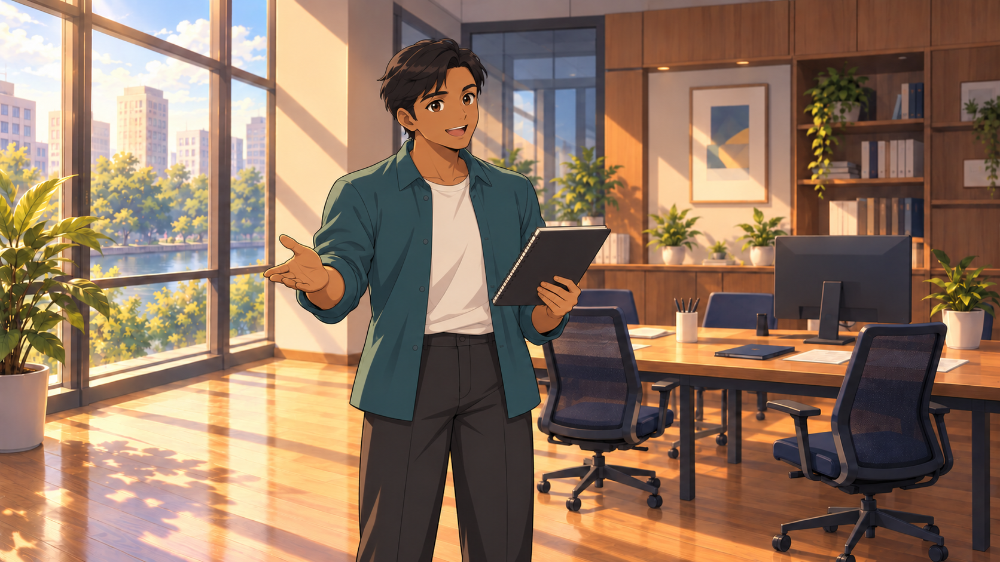
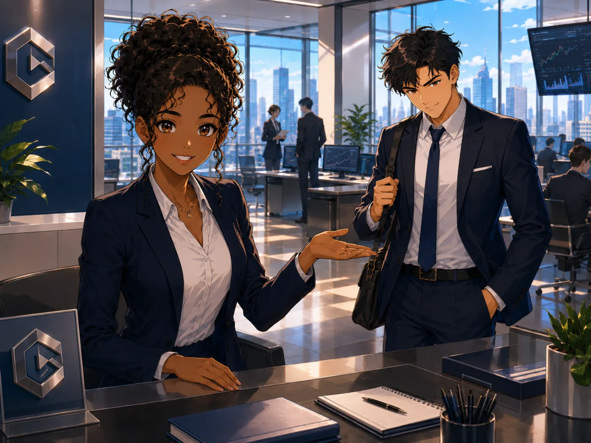
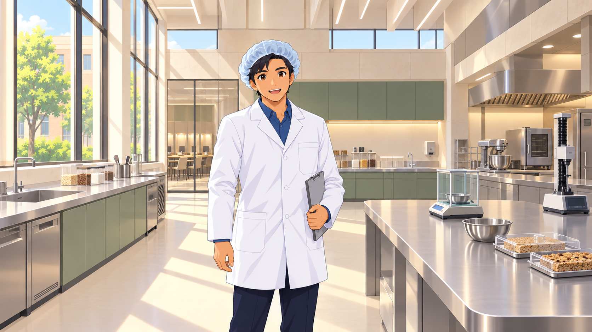

# Visual reference library

These are actual files from Dreamari, included so the SOP is portable. They establish drawing treatment, not new character identities. They are production references, not a record of human approval of this new Food Scientist revision.

| File | Use | Do not transfer |
|---|---|---|
| ux-character.png | PRIMARY drawing anchor: economical anime face, expressive eyes, small nose/mouth, large hair shapes, cel shadows | Arjun’s ethnicity, face, hairstyle, outfit or office |
| nursing-character.png | Supporting anime contour/eye treatment and character integration into a functional workplace | Clinical props, jewellery, pose, hospital geography |
| ib-character.webp | Supporting cast distinction, professional staging and attractive spatial composition | Dense curls, extra facial/fabric rendering, finance props or visible stand-in for the player |
| food-lab.png | Current food-science environment candidate: designed pilot-preparation/testing space, selective painted detail | A universal room template for every career |

Use one PRIMARY drawing anchor in every generation. Do not average three styles. The latest written detail ceiling overrides more detailed regions in older references. New backgrounds must keep the career’s functions and sophisticated architectural design, with painted anime materials rather than photographic surface noise. Inspect faces at matched display size AND the assembled game at desktop/phone size. A generation prompt alone cannot certify continuity.
